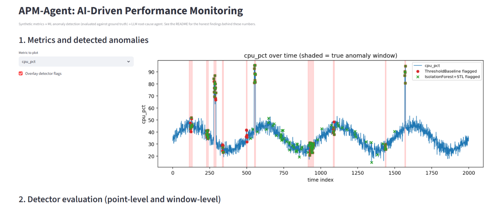

# APM-Agent

An AI-driven application performance monitoring tool: ingests system metrics,
detects anomalies with ML, diagnoses root causes with an LLM agent, and
visualizes the whole pipeline in a browser dashboard.



## Status: Phases 1–3 and 5 complete (simulator, detection, RCA agent, dashboard)

**Phase 1 — Metrics simulator**: generates a realistic synthetic metrics time
series (latency, CPU, memory, error rate, throughput) with injectable,
**ground-truth-labeled** anomalies (CPU spikes, latency spikes, gradual
memory leaks, error bursts).

**Phase 2 — Detection + evaluation**: two detectors, scored against each
other on the same ground truth, not just demoed in isolation:
- `ThresholdBaseline` — flags a point if any metric's z-score exceeds a cutoff.
- `IsolationForestDetector` — STL decomposition per metric, then Isolation
  Forest on the residuals jointly across all metrics, to catch correlated
  multivariate anomalies a per-metric threshold would miss.
- `evaluate.py` — precision, recall, F1, and false-positive rate at both
  point-level (strict) and window-level (an alert anywhere in the window
  counts as a catch — closer to how real alerting tools are judged).

**Honest finding**: `ThresholdBaseline` outperforms `IsolationForest+STL` on
this dataset at both levels. The injected anomalies are sharp, sudden
shifts — close to the ideal case for a z-score cutoff — so STL's
seasonality-removal adds noise rather than signal here. At window-level,
Isolation Forest's recall improves to 0.90 (9/10 windows caught) but
precision drops to 0.18 because it fires 40 separate single-point
false-alarm episodes. **Identified next step (not yet built)**: alert
debouncing — only firing on N consecutive flagged points, not a single
blip — standard practice in real monitoring systems to avoid alert fatigue.

**Phase 3 — RCA agent**: given a flagged anomaly, the agent runs a genuine
multi-step investigation rather than a single prompt-in-answer-out call:
- `src/agent/tools.py` — evidence-gathering tools (runbook lookup, log
  query, correlated-metrics check, deployment history), mocked but
  structured exactly like real integrations would be.
- `src/agent/llm_client.py` — a pluggable `LLMClient` interface (Gemini
  today via `google-genai`), plus **exponential backoff with jitter** for
  transient API errors (429/500/502/503/504) — verified against a real
  sustained Gemini outage during development, not just simulated in tests.
- `src/agent/agent.py` — the loop: hypothesize → pick a tool → observe →
  revise or conclude, up to 5 steps. The agent **rejects empty or missing
  diagnoses** and pushes the model to retry rather than silently accepting
  a blank answer, and prints each step live as it happens so a crash
  doesn't lose visibility into prior progress. If evidence is genuinely
  insufficient, it reports `max_steps_reached` with 0% confidence rather
  than fabricating certainty.
- `src/agent/run_rca.py` — end-to-end CLI: loads a real flagged anomaly
  from the detector's output and runs the agent against it via Gemini.

The agent loop is tested with a scripted fake LLM (`FakeLLMClient`) — tool
execution, markdown-fenced JSON parsing, the max-steps fallback, empty-
diagnosis rejection, and low-confidence conclusions are all verified
without needing a real API key or network access.

**Confirmed finding from live runs (CLI and dashboard, 4+ separate runs)**:
`gemini-3.5-flash-lite` reliably picks correct tool names — including
self-correcting after an unknown-action error — but consistently leaves
the free-text `thought` and `diagnosis` fields empty, even when explicitly
instructed to fill them and after the agent's empty-diagnosis rejection
gives it extra chances. This is a stable, reproducible characteristic of
this specific budget-tier model, not a one-off. Worth noting: an
empty-diagnosis retry consumes a full step, so on a model with this
behavior most of the step budget can go to re-asking for a diagnosis
rather than gathering more evidence — a concrete, specific limitation
rather than a vague "sometimes it doesn't work." The agent does not paper
over this: it honestly reports `max_steps_reached` with 0% confidence
instead of showing a fabricated answer. `gemini-3.5-flash` (non-lite) was
not evaluated for this specific behavior, since it was consistently
overloaded (503) during testing — a separate, transient capacity issue the
retry-with-backoff logic handles regardless of which model is in use.

**Phase 5 — Dashboard**: a Streamlit app tying all three phases together
in a browser.
- `src/dashboard/data.py` / `charts.py` — plain, Streamlit-free functions
  (data loading, matplotlib figure building) tested directly.
- `src/dashboard/app.py` — the UI: a metric time series with ground-truth
  anomaly windows shaded and both detectors' flags overlaid, point- and
  window-level evaluation tables and bar charts side by side, and a picker
  to run the live RCA agent against any of the 10 anomalies with the
  reasoning trace shown as expandable steps.

Run with `streamlit run src/dashboard/app.py` (after generating data).

## Setup

```bash
python -m venv venv
source venv/bin/activate  # Windows: venv\Scripts\activate
pip install -r requirements.txt
```

For the LLM agent, you'll need a Gemini API key:

```bash
cp .env.example .env
# edit .env and add your GEMINI_API_KEY (and optionally GEMINI_MODEL)
```

## Usage

Generate a fresh synthetic dataset:
```bash
python -m src.simulator.metrics_simulator
```
This writes `data/metrics.db` (all metric points) and
`data/anomaly_labels.json` (ground-truth anomaly windows).

Run the detector evaluation:
```bash
python -m src.detector.evaluate
```

Run the RCA agent end-to-end on the command line:
```bash
python -m src.agent.run_rca
```

Launch the dashboard:
```bash
streamlit run src/dashboard/app.py
```

Run tests (agent and dashboard tests use fakes/stand-ins — no API key or
real Streamlit server needed):
```bash
pytest tests/ -v
```

## Architecture

Simulator -> SQLite -> Anomaly Detector (Isolation Forest + STL) -> Alert Queue
| |
v v
Evaluation Harness RCA Agent (Gemini,
(precision/recall/F1 vs. tool-calling, retry/
threshold baseline, backoff, honest
point- and window-level) low-confidence)
\ /
\ /
v v
Streamlit Dashboard
(metrics + evaluation + live agent investigation)


## Roadmap

- [x] Phase 1 — Metrics simulator with labeled synthetic anomalies
- [x] Phase 2 — Anomaly detection (STL + Isolation Forest) with evaluation harness (precision/recall/F1, point- and window-level, vs. threshold baseline)
- [x] Phase 3 — LLM root-cause agent (Gemini, multi-step tool-calling, tested with a scripted fake LLM)
- [x] Phase 3.5 — Resilience for the LLM call path: exponential backoff/retry on transient errors (proven against a real sustained outage), live step-by-step progress printing, rejection of empty diagnoses
- [x] Phase 5 — Streamlit dashboard tying all phases together, with a live agent investigation picker
- [ ] Phase 4 — Resilience for the ingestion/detection path (async ingestion, circuit breaker)
- [ ] Alert debouncing for the detector (identified in Phase 2's honest finding, not yet built)

## Design notes

- **Ground truth first**: the simulator labels every anomaly it injects, so
  detector quality is measured, not assumed.
- **Pluggable LLM backend**: the agent calls a single `LLMClient` interface
  so the backend (Gemini today) can be swapped without touching agent logic.
- **Honesty over fabrication**: both the detector evaluation and the agent
  are built to surface their own weak results — a losing detector
  comparison, an agent that reports "insufficient evidence" — rather than
  hide them. This was a deliberate choice, not an accident of what the
  numbers happened to show.
- **Synthetic data, honestly labeled as such**: this is a portfolio/learning
  project, not a claim of production-scale validation.

